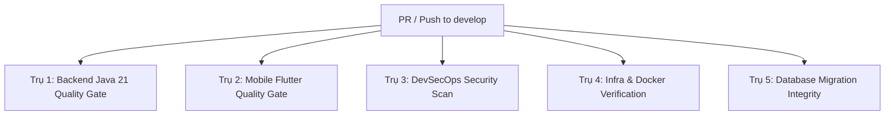

# 🚀 CI/CD EVOLUTION ROADMAP (Lộ Trình Tiến Hóa CI)

> **Dự án:** Smart Local Planner  
> **Áp dụng cho:** `.github/workflows/ci.yml`  
> **Nguyên tắc:** *CI/CD phải tiến hóa song hành với độ chín của dự án.* Không bật các rào cản kiểm thử quá sớm khi chưa viết code, nhưng phải nâng dần độ khắt khe qua từng Sprint để đảm bảo chất lượng phần mềm chuẩn Enterprise (tương tự quy chuẩn của `eform`).

---

## 🗺️ Bản Đồ Nâng Cấp CI Theo Từng Sprint

```text
[ Sprint 0: Foundation ] ──► [ Sprint 1: Core Logic ] ──► [ Sprint 2: Fullstack ] ──► [ Sprint 3+: Release ]
  - Java 21 LTS Setup          - Backend Unit Tests          - Flutter Analyzer         - Docker Build Verification
  - Maven Dependency Cache     - Spotless / Checkstyle       - Flutter Widget Tests     - Sonatype Dependency Check
  - mvn test-compile           - Fail on Test Failure        - Flyway Migration Check   - Multi-platform Quality Gate
```

---

## 📌 GIAI ĐOẠN 1: SPRINT 0 (Hiện Tại - Nền Móng Cơ Bản)

### 🎯 Mục tiêu
Đảm bảo mã nguồn biên dịch thành công, không bị lỗi cú pháp Java, tải cache thư viện Maven mượt mà, không chặn dev khi chưa viết bài test nào.

### ⚙️ Cấu hình `ci.yml` hiện hành
* **Triggers:** `push` và `pull_request` trên `develop` và `main`.
* **Runner:** `ubuntu-latest`.
* **Actions:** `actions/checkout@v4`, `actions/setup-java@v4` (Java 21 LTS, Eclipse Temurin).
* **Lệnh chạy:**
  ```bash
  mvn -B clean test-compile
  ```
* **Lý do:** Chỉ kiểm tra biên dịch mã nguồn và cấu hình POM. Không bắt buộc phải có test case.

---

## 📌 GIAI ĐOẠN 2: SPRINT 1 (Core Backend & Data Layer)

### 🎯 Mục tiêu khi chuyển sang Sprint 1
Khi nhóm bắt đầu viết JPA Entities (`Place`), Repositories, Services và viết Unit Test đầu tiên: **Bắt buộc code phải pass test 100% mới được merge vào `develop`.**

### 🛠️ Thay đổi cần làm trong `.github/workflows/ci.yml`:
Chuyển lệnh build từ `test-compile` sang chạy kiểm thử thực thụ:

```yaml
      - name: Run Backend Unit Tests with Maven
        working-directory: backend
        run: mvn -B test
```

### 🛡️ Tiêu chuẩn chất lượng (Quality Gate):
* Mọi pull request nếu làm hỏng Unit Test cũ ➡️ **CI Báo Đỏ ❌ ➡️ Không cho phép Merge**.

---

## 📌 GIAI ĐOẠN 3: SPRINT 2 (Fullstack Integration - Thêm Mobile Flutter)

### 🎯 Mục tiêu
Khi dự án bắt đầu code Mobile (`flutter_bloc`, màn hình Flutter): Bổ sung thêm một Job chạy song song để kiểm tra Flutter (tương tự như Job `frontend` của `eform`).

### 🛠️ Cấu hình bổ sung vào `.github/workflows/ci.yml`:

```yaml
  mobile-ci:
    name: Mobile Quality Gate (Flutter)
    runs-on: ubuntu-latest
    steps:
      - name: Checkout code
        uses: actions/checkout@v4

      - name: Setup Java (Android dependency)
        uses: actions/setup-java@v4
        with:
          distribution: 'temurin'
          java-version: '17'

      - name: Setup Flutter SDK
        uses: subosito/flutter-action@v2
        with:
          channel: 'stable'
          cache: true

      - name: Install Mobile Dependencies
        working-directory: mobile
        run: flutter pub get

      - name: Static Code Analysis (Flutter Linter)
        working-directory: mobile
        run: flutter analyze

      - name: Run Mobile Unit & Widget Tests
        working-directory: mobile
        run: flutter test
```

---

## 📌 GIAI ĐOẠN 4: SPRINT 3 & PRODUCTION (Enterprise Full-Blown Quality Gate)

### 🎯 Mục tiêu
Đạt độ hoàn thiện tương đương hoặc vượt trội hơn các dự án quy mô doanh nghiệp như `eform`, bao phủ toàn diện 5 trụ cột: Backend, Mobile, An ninh bảo mật, Hạ tầng container và Tính toàn vẹn của Cơ sở dữ liệu.

---

## 🏛️ KIẾN TRÚC CHI TIẾT 5 TRỤ CỘT CI HOÀN CHỈNH



### 1. Trụ 1: Backend Java 21 Quality Gate
* **Mục đích:** Đảm bảo mã nguồn Spring Boot 3 sạch, không lỗi biên dịch, đạt chuẩn kiến trúc 3 tầng và vượt qua 100% kiểm thử.
* **Các bước chi tiết:**
  1. `actions/checkout@v4` & `actions/setup-java@v4` (Java 21 LTS, phân phối Temurin, kích hoạt cache Maven).
  2. `mvn spotless:check` hoặc `checkstyle:check`: Soi chuẩn định dạng code (Google Java Style), cấm import thừa.
  3. `mvn clean test`: Chạy toàn bộ Unit Tests (Mock Service & Repository).
  4. `jacoco:report`: Xuất báo cáo độ phủ mã nguồn (Code Coverage). Ngưỡng tối thiểu: > 70% coverage.

### 2. Trụ 2: Mobile Flutter Quality Gate
* **Mục đích:** Đảm bảo ứng dụng Flutter biên dịch ổn định trên cả Android & iOS, tuân thủ Clean Architecture + BLoC.
* **Các bước chi tiết:**
  1. `subosito/flutter-action@v2` (Kênh `stable`, kích hoạt cache pub dependencies).
  2. `flutter pub get`: Tải và kiểm tra tính tương thích của các package.
  3. `flutter analyze`: Phân tích tĩnh cú pháp Dart (bắt lỗi logic, biến không dùng, thiếu kiểu dữ liệu).
  4. `flutter test --coverage`: Chạy Unit Tests và Widget Tests ở chế độ headless (không cần giả lập máy thật).

### 3. Trụ 3: DevSecOps Security Scan (Bảo Mật Tự Động)
* **Mục đích:** Ngăn chặn lộ lọt bí mật nghiệp vụ và lỗ hổng thư viện bên thứ ba (tương đương Nancy trong `eform`).
* **Các bước chi tiết:**
  1. **Secret Leak Detection (TruffleHog):** Quét commit diff để phát hiện vô tình commit file `.env`, mật khẩu DB, Google Maps API Key, JWT secret.
  2. **Dependency Vulnerability Scan (Trivy / Dependabot):** Quét toàn bộ file `pom.xml` và `pubspec.lock` để phát hiện các thư viện dính mã độc CVE đã công bố.

### 4. Trụ 4: Infra & Docker Verification (Hạ Tầng)
* **Mục đích:** Đảm bảo môi trường triển khai container hóa (Docker) an toàn và build thành công.
* **Các bước chi tiết:**
  1. `hadolint`: Soi file `Dockerfile` của Backend (cấm chạy quyền `root`, cấm dùng image không rõ nguồn gốc).
  2. `reviewdog/action-yamllint`: Soi tính toàn vẹn cú pháp của các file `docker-compose.yml` và `.github/workflows/*.yml`.
  3. `docker build`: Chạy thử đóng gói container Backend ở chế độ smoke-test để đảm bảo image chạy được khi deploy.

### 5. Trụ 5: Database Migration Integrity (Flyway Check)
* **Mục đích:** Bảo vệ cơ sở dữ liệu production không bị sập bởi các file SQL viết sai cú pháp.
* **Các bước chi tiết:**
  1. Khởi động service container PostgreSQL tạm thời trong GitHub Actions.
  2. Chạy `mvn flyway:migrate` để kiểm tra toàn bộ file từ `V1__init_schema.sql`, `V2__seed_places.sql`... có chạy trơn tru và nhất quán checksum không.

---

## ⚠️ MA TRẬN ĐÁNH GIÁ YẾU TỐ RỦI RO (RISK & TRADE-OFF ANALYSIS)

Trước khi kích hoạt các bước kiểm tra, Tech Lead cần nắm rõ các yếu tố có thể gây bất lợi cho nhóm:

| Bước kiểm tra | Yếu tố rủi ro tiềm ẩn (Nếu làm không khéo) | Giải pháp tối ưu hóa chuẩn Enterprise |
| :--- | :--- | :--- |
| **Quét bảo mật thư viện (Dependency Check)** | Nếu dùng plugin OWASP CLI truyền thống, nó sẽ tải 2GB dữ liệu NVD mỗi lần chạy ➡️ **CI mất 10-15 phút, gây timeout!** | **Giải pháp:** Dùng **Trivy Action** hoặc **GitHub Dependabot** tích hợp sẵn ➡️ Quét chỉ mất dưới 15 giây. |
| **Flutter Mobile CI** | Nếu cố tình build file `.apk` hay `.ipa` trên mỗi commit ➡️ Tốn 8-10 phút và đốt sạch 2.000 phút free của GitHub Actions! | **Giải pháp:** Chỉ chạy `flutter analyze` và `flutter test` (chế độ headless mất 45 giây). Chỉ build APK khi tạo Release Tag. |
| **Linter kiểm tra cú pháp** | Nếu cấu hình quy tắc quá khắt khe (bắt bẻ từng dấu cách, bắt viết Javadoc từng hàm nhỏ) ➡️ Khiến dev ức chế, nản lòng. | **Giải pháp:** Chỉ bật các rule bảo vệ logic cốt lõi (Unused variables, Null safety, Code duplication). |
| **Chạy Test Backend có Database** | Nếu test Service mà cố kết nối DB thật trên local mà runner không có ➡️ Bị lỗi `Connection Refused` sập CI. | **Giải pháp:** Tách bạch: Unit Test dùng Mockito (chạy 5 giây không cần DB). Integration Test mới dùng PostgreSQL Service container. |

---

## 📋 Checklist Chuyển Đổi Khi Sang Sprint Mới

Khi bắt đầu một Sprint mới, Tech Lead thực hiện các bước sau:
- [ ] **Bước 1:** Mở file này (`.github/CI_ROADMAP.md`).
- [ ] **Bước 2:** Đọc yêu cầu của Sprint tương ứng.
- [ ] **Bước 3:** Tạo nhánh `feature/ci-sprint-<X>`.
- [ ] **Bước 4:** Cập nhật các bước mới vào `.github/workflows/ci.yml`.
- [ ] **Bước 5:** Test thử nghiệm trên nhánh cá nhân, đảm bảo xanh mượt trước khi mở PR vào `develop`.
