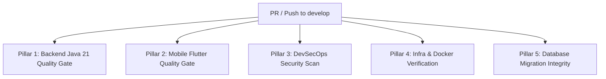

# 🚀 CI/CD Evolution Roadmap & Sprint Quality Gate

> **Project:** Smart Local Planner  
> **Applies to:** `.github/workflows/ci.yml`  
> **Core Principle:** *CI/CD must evolve concurrently with the project maturity stage.* Avoid premature over-enforcement when initial code has not been authored, but progressively elevate quality gates across Sprints to achieve enterprise-grade stability (benchmarked against production-grade systems like `eform`).

---

## 🗺️ Sprint-by-Sprint CI Evolution Map

```text
[ Sprint 0: Foundation ] ──► [ Sprint 1: Core Logic ] ──► [ Sprint 2: Fullstack ] ──► [ Sprint 3+: Release ]
  - Java 21 LTS Setup          - Backend Unit Tests          - Flutter Analyzer         - Docker Build Verification
  - Maven Dependency Cache     - Spotless / Google Style     - Flutter Widget Tests     - Sonatype / Trivy Security
  - mvn test-compile           - Test Failure Blockers       - Flyway Migration Check   - Multi-platform Quality Gate
```

---

## 📌 Phase 1: Sprint 0 (Current Baseline - Infrastructure Foundation)

### 🎯 Objective
Guarantee that Java 21 backend builds and compiles cleanly, dependencies are cached, line endings are normalized, and developers are not prematurely blocked before test suites exist.

### ⚙️ Active `ci.yml` Configuration
* **Triggers:** `push` and `pull_request` targeting `develop` and `main`.
* **Runner:** `ubuntu-latest`.
* **Actions:** `actions/checkout@v4`, `actions/setup-java@v4` (Java 21 LTS, Eclipse Temurin, `cache: 'maven'`).
* **JVM Tuning:** `MAVEN_OPTS: "-Xmx2048m -XX:+TieredCompilation -XX:TieredStopAtLevel=1"`.
* **Verification Command:**
  ```bash
  mvn -B clean test-compile
  ```
* **Rationale:** Validates Maven POM dependencies and bytecode compilation without failing due to zero existing test cases.

---

## 📌 Phase 2: Sprint 1 (Core Backend Domain & Data Layer)

### 🎯 Objective
As JPA Entities (`Place`), Repositories, Services, and unit tests are introduced: **Enforce 100% test pass rate on all Pull Requests targeting `develop`.**

### 🛠️ Configuration Update in `.github/workflows/ci.yml`:
Upgrade verification command from `test-compile` to active test suite execution:

```yaml
      - name: Run Backend Unit Tests with Maven
        working-directory: backend
        run: mvn -B test
```

### 🛡️ Quality Gate Enforcement:
* Any commit that breaks existing unit tests triggers **CI Failure ❌ ➔ Block Merge**.

---

## 📌 Phase 3: Sprint 2 (Fullstack Integration - Mobile Flutter)

### 🎯 Objective
As mobile features (`flutter_bloc`, presentation screens) are authored under `mobile/`: Introduce a parallel Job to validate Dart code quality and widget tests (analogous to the `frontend` job in `eform`).

### 🛠️ Job Definition to Append into `.github/workflows/ci.yml`:

```yaml
  mobile-ci:
    name: Mobile Quality Gate (Flutter)
    runs-on: ubuntu-latest
    steps:
      - name: Checkout Repository
        uses: actions/checkout@v4

      - name: Set up Java 17 (Android Build Tools)
        uses: actions/setup-java@v4
        with:
          distribution: 'temurin'
          java-version: '17'

      - name: Set up Flutter SDK
        uses: subosito/flutter-action@v2
        with:
          channel: 'stable'
          cache: true

      - name: Install Mobile Dependencies
        working-directory: mobile
        run: flutter pub get

      - name: Static Analysis (Dart Analyzer)
        working-directory: mobile
        run: flutter analyze

      - name: Run Headless Mobile Tests
        working-directory: mobile
        run: flutter test --coverage
```

---

## 📌 Phase 4: Sprint 3 & Production (Enterprise Full-Blown Quality Gate)

### 🎯 Objective
Achieve full parity with enterprise compliance standards across 5 architectural pillars: Backend, Mobile, DevSecOps Security, Infrastructure Containers, and Database Integrity.

---

## 🏛️ The 5 Pillars of Enterprise CI Architecture



### 1. Pillar 1: Backend Java 21 Quality Gate
* **Purpose:** Ensure clean 3-layer architecture, zero compiler warnings, and test coverage adherence.
* **Steps:**
  1. `actions/checkout@v4` & `actions/setup-java@v4` (Java 21 LTS, Temurin, Maven caching).
  2. `mvn spotless:check` or `checkstyle:check` (Google Java Format compliance, no unused imports).
  3. `mvn clean test` (Mocked Unit Tests via Mockito & JUnit 5).
  4. `jacoco:report` (Code coverage verification threshold: > 70%).

### 2. Pillar 2: Mobile Flutter Quality Gate
* **Purpose:** Verify cross-platform client integrity and BLoC state transition invariants.
* **Steps:**
  1. `subosito/flutter-action@v2` (`stable` channel, pub cache enabled).
  2. `flutter pub get` (Resolve dependency graphs).
  3. `flutter analyze` (Static analysis for null-safety, dead code, and lint rules).
  4. `flutter test --coverage` (Headless unit & widget tests; under 45 seconds).

### 3. Pillar 3: DevSecOps Security Scan
* **Purpose:** Prevent secret leaks and vulnerable third-party dependencies (analogous to Nancy in `eform`).
* **Steps:**
  1. **Secret Leak Detection (TruffleHog):** Scans git commit diffs for leaked `.env`, database credentials, Google Maps API keys, or JWT secrets.
  2. **Dependency Vulnerability Scan (Trivy / Dependabot):** Scans `pom.xml` and `pubspec.lock` against public CVE databases.

### 4. Pillar 4: Infrastructure & Container Verification
* **Purpose:** Ensure container definitions are production-hardened and secure.
* **Steps:**
  1. `hadolint`: Lints `backend/Dockerfile` (blocks root user execution, unpinned base images).
  2. `reviewdog/action-yamllint`: Validates syntax of `docker-compose.yml` and `.github/workflows/*.yml`.
  3. `docker build`: Smoke tests backend container packaging without deploying.

### 5. Pillar 5: Database Migration Integrity (Flyway Check)
* **Purpose:** Prevent production schema corruption caused by malformed SQL scripts or checksum alterations.
* **Steps:**
  1. Spin up ephemeral PostgreSQL 16 service container in GitHub Actions.
  2. Execute `mvn flyway:migrate` to verify that all historical scripts (`V1__...`, `V2__...`) execute idempotently.

---

## ⚠️ Risk & Trade-off Evaluation Matrix

| Inspection Step | Potential Pitfall If Misconfigured | Enterprise Best Practice Solution |
| :--- | :--- | :--- |
| **Dependency Vulnerability Scanning** | Traditional OWASP CLI downloads 2GB NVD database on every run ➔ **10-15 minute CI runtime and timeouts.** | Use **Trivy Action** or native **GitHub Dependabot** ➔ Scans complete in under 15 seconds. |
| **Flutter Mobile CI** | Compiling physical `.apk` or `.ipa` on every commit ➔ Consumes 8-10 minutes and exhausts monthly GitHub minutes. | Run only `flutter analyze` and `flutter test` in headless mode (40s). Build APKs exclusively on Release Tags. |
| **Linter / Static Analysis** | Overly pedantic styling rules (failing builds on minor whitespace or missing trivial javadoc) ➔ Frustrates engineers. | Enforce only critical defect prevention rules (Unused imports, Null safety, Code duplication). |
| **Backend Integration Tests** | Test suites attempting to connect to `localhost:5432` without an active database ➔ `Connection Refused` CI crashes. | Isolate: Unit Tests mock dependencies via Mockito (runs in 5s). Integration Tests use ephemeral PostgreSQL service containers. |

---

## 📋 Sprint Transition Checklist

When commencing a new Sprint, the Tech Lead performs:
- [ ] **Step 1:** Review this roadmap specification (`.github/CI_ROADMAP.md`).
- [ ] **Step 2:** Identify the target Sprint quality gate requirements.
- [ ] **Step 3:** Create a working branch: `feat/ci-sprint-<X>`.
- [ ] **Step 4:** Incorporate the corresponding job configurations into `.github/workflows/ci.yml`.
- [ ] **Step 5:** Validate green execution on the feature branch before opening PR into `develop`.
