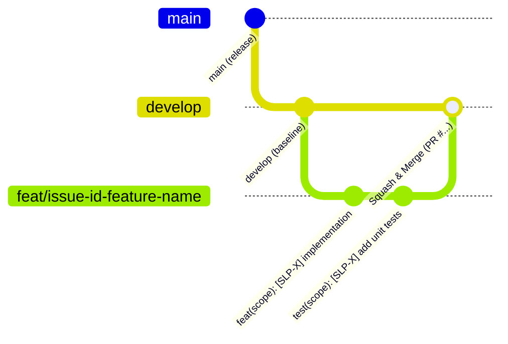

# Developer Playbook & Contribution Guide

> **Project:** Smart Local Planner  
> **Status:** Active Engineering — Enterprise Monorepo Governance & Standards  
> **Target Audience:** All Contributing Engineers, Peer Reviewers, and AI Assistants  
> **Standard:** Enterprise Greenfield Guidelines & Zero-Tolerance Pitfall Prevention  
> **Operational Runbook:** See the comprehensive [Developer Workflow Playbook](docs/DEVELOPER_WORKFLOW_PLAYBOOK.md) for step-by-step issue, board, and PR execution.

---

## 1. Engineering Philosophy

Welcome to **Smart Local Planner**! This repository is engineered following strict enterprise architectural patterns. To maintain velocity, code health, and zero merge headaches across the team, all contributors **must strictly comply** with this guide.

* **Project Governance & Red Lines:** Defined in this document (`CONTRIBUTING.md`).
* **Daily Sprint Execution & Board SOP:** Detailed step-by-step in [`docs/DEVELOPER_WORKFLOW_PLAYBOOK.md`](docs/DEVELOPER_WORKFLOW_PLAYBOOK.md).
* **AI Coding Protocols & Prompt Templates:** Included in [`docs/DEVELOPER_WORKFLOW_PLAYBOOK.md §5`](docs/DEVELOPER_WORKFLOW_PLAYBOOK.md#5-ai-pair-programming-protocol-prompting-guide).

---

## 2. Zero-Tolerance Engineering Constraints

Before writing any code, review these 5 non-negotiable rules. Violating any of these will cause GitHub CI or PR Review to reject your submission immediately.

> [!CAUTION]
> Breaking any of these constraints introduces technical debt and breaks continuous integration for the entire team.

| Pitfall | Root Risk | Mandatory Enterprise Rule |
| :--- | :--- | :--- |
| **1. Modifying Historical Migrations** | Causes `FlywayChecksumMismatch` and crashes peer databases. | **NEVER touch existing historical migrations (`V1`, `V2`, `V3`, `V4`, ...).** Always check `backend/src/main/resources/db/migration/` and create the next incremental `V<N+1>__<description>.sql` file. |
| **2. Direct Push of Code to develop/main** | Destroys branch integrity and bypasses CI automated quality gates. | **NEVER push application code, migrations, or configs directly to `develop`/`main`.** Always branch off `develop` via `<type>/<issue_number>-<short-description>` and submit a PR.<br>*(Pragmatic Exemption: Pure documentation `.md` / typo fixes can be pushed directly to `develop` after running `git pull origin develop`)*. |
| **3. Credential or Secret Leaks** | Compromises database credentials and API service keys. | **NEVER commit `.env`, passwords, or private keys.** Only `.env.example` with dummy placeholders is tracked. |
| **4. Architectural Layer Bleeding** | Couples storage layer with external HTTP transport. | **Backend:** Controllers must never return JPA Entities.<br>**Mobile:** UI must handle all 4 states (Loading, Success, Error, Empty). |
| **5. Uninformative Commit Messages** | Prevents automated changelog generation and commit auditing. | **Commits like "fix", "wip", "update" are blocked.** All commits must follow `<type>(<scope>): [SLP-X] <subject>`. (The `Closes #<issue_number>` keyword belongs in the PR Description). |

---

## 3. Database Migration Protocol (Flyway Immutability)

Flyway calculates a **cryptographic SHA-256 checksum** of every migration file upon first execution and records it in `flyway_schema_history`.

### Anti-Pattern: Modifying Existing Migrations
Modifying an already executed migration (e.g. editing `V1__init_schema.sql` or `V4__create_refresh_tokens.sql` to alter a column).  
**Consequence:** Next time the application starts, Flyway throws:
`FlywayValidateException: Migration checksum mismatch for migration version ...` and terminates the process.

### Standard: Add Incremental Migrations
1. Leave all existing historical migrations (`V1` through `V4`) untouched forever.
2. Inspect `backend/src/main/resources/db/migration/` to find the highest existing version `N`.
3. Create the next consecutive incremental file `V<N+1>__<short_description>.sql` (e.g., `V5__add_user_preferences.sql`):
   ```sql
   ALTER TABLE users ADD COLUMN phone VARCHAR(20);
   ```

### Emergency Local Recovery (Resolving Local Checksum Discrepancies)
* **Option A (Revert Local File):**
  ```bash
  git restore backend/src/main/resources/db/migration/
  ```
* **Option B (Flyway Repair — run from `backend/`):**
  ```bash
  cd backend && ./mvnw flyway:repair
  # On Windows PowerShell:
  cd backend; .\mvnw.cmd flyway:repair
  ```
* **Option C (Fresh Docker Reset — run from repository root):**
  ```bash
  docker compose down -v && docker compose up -d
  ```

---

## 4. Standard Daily Git Workflow

The diagram below illustrates the **Universal Enterprise Git Workflow** applied to every task in this repository. It demonstrates how a developer branches off `develop`, makes scoped conventional commits, and merges back cleanly via a Pull Request.



### Git Workflow Formula & Reference Matrix

| Element | Standard Formula Pattern | Concrete Real-World Example | Purpose & Notes |
| :--- | :--- | :--- | :--- |
| **Integration Baseline** | `develop` | `develop` | The single source of truth for ongoing sprint work. |
| **Feature Branch** | `feat/<issue_number>-<short-description>` | `feat/49-jwt-architecture` | Branches off `develop`. Uses GitHub Issue ID (`#49`). |
| **Bugfix / Hardening Branch** | `fix/<issue_number>-<short-description>` | `fix/44-place-card-null-image` | Quick fixes or hardening issues. |
| **Commit Message** | `<type>(<scope>): [SLP-X] <subject>` | `feat(auth): [SLP-22] add jwt service` | Follows Conventional Commits with Jira backlog key (`[SLP-22]`). |
| **PR Merge Strategy** | `Squash and merge` into `develop` | `PR #58` merged into `develop` | Collapses branch commits into 1 atomic history commit.<br>*(Note: GitHub PR numbers auto-increment globally and will differ from the Issue number)*. |

---

### Step 1: Synchronize with integration baseline
Always ensure your local `develop` branch has the latest peer changes before creating your feature branch:
```bash
git switch develop
git pull origin develop
```

### Step 2: Create a feature branch
Follow the `<type>/<issue_number>-<short-description>` formula:
```bash
# Example for a new feature (GitHub Issue #49):
git switch -c feat/49-jwt-architecture

# Example for a bug fix (GitHub Issue #44):
git switch -c fix/44-place-card-null-image
```

### Step 3: Write code & test locally
Verify that your changes compile and pass tests before pushing:
```bash
# 1. Backend verification (unit tests & quality gate):
cd backend
./mvnw test               # On Windows PowerShell: .\mvnw.cmd test

# 2. Mobile verification (static analysis linter and test suite):
cd ../mobile
flutter analyze
flutter test

# 3. Return to repository root:
cd ..
```

### Step 4: Commit with Conventional Commits
Format: `<type>(<scope>): [SLP-X] <subject>`  
*(Note: Do not put `closes #...` in branch names or commit messages. The `Closes #<issue_number>` keyword belongs cleanly in the PR Description!)*

```bash
git add .
git commit -m "feat(auth): [SLP-22] add jwt token validation service"
git push -u origin feat/49-jwt-architecture
```

### Step 5: Open Pull Request
* Base branch: `develop` ⬅️ Compare branch: `feat/49-jwt-architecture`.
* Use the standardized 3-section enterprise PR template:
  ```markdown
  ## Summary of Changes
  - **Auth (`JwtService.java`)**:
    - Implemented HMAC-SHA256 token verification with cached signing key.
    - Added unit test suite covering expiration and signature tampering.

  ## Verification
  - `./mvnw test` passed with 100% assertions green.

  Closes #49
  ```
* Wait for dual CI quality gate (`Spring Boot 3 Compile & Verification` and `Flutter Mobile Quality Gate`) to turn green.
* Perform **Squash & Merge** into `develop`, delete feature branch, and sync local `develop`.

---

## 5. Troubleshooting Common Issues

| Issue / Error | Root Cause | Remediation Command |
| :--- | :--- | :--- |
| `bash: ./mvnw: Permission denied` | Git index missing Linux executable bit | Run `git update-index --chmod=+x backend/mvnw` and commit. |
| `File ... mvnw cannot be loaded (ExecutionPolicy)` | Windows PowerShell script execution policy restricted | Run `.\mvnw.cmd test` or `Set-ExecutionPolicy -Scope Process -ExecutionPolicy Bypass`. |
| `Git LF will be replaced by CRLF` | Windows vs Linux line ending differences | Managed automatically via `.gitattributes`. |
| `Protected branch hook declined` | Attempted direct push to `develop` | Branch protection active. Create a `feat/...` branch and open a PR. |
| `Exit code 137 (OOM Killer)` | Maven process exceeded runner memory limit | `MAVEN_OPTS` is configured to `-Xmx2048m` in `ci.yml` to prevent exhaustion. |

---

## 6. Associated Documentation Links

* Step-by-Step Sprint Playbook: [docs/DEVELOPER_WORKFLOW_PLAYBOOK.md](docs/DEVELOPER_WORKFLOW_PLAYBOOK.md)
* Developer Onboarding Guide: [docs/ONBOARDING.md](docs/ONBOARDING.md)
* System Architecture Blueprint: [docs/ARCHITECTURE_BLUEPRINT.md](docs/ARCHITECTURE_BLUEPRINT.md)
* Clean Code & Architecture Rules: [docs/DEVELOPMENT_GUIDELINES.md](docs/DEVELOPMENT_GUIDELINES.md)
* REST API JSON Specification: [docs/API_SPECIFICATION.md](docs/API_SPECIFICATION.md)
* CI Roadmap & Evolution: [.github/CI_ROADMAP.md](.github/CI_ROADMAP.md)
* Security Policy & Vulnerability Reporting: [SECURITY.md](SECURITY.md)
