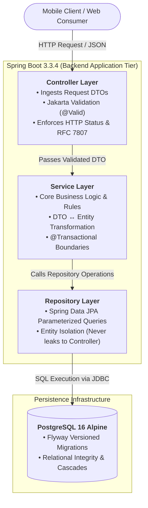
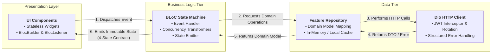
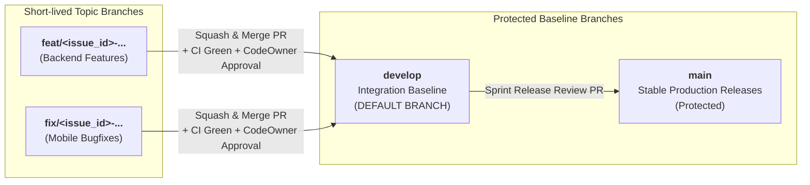

# Smart Local Planner

[](https://openjdk.org/projects/jdk/21/)
[](https://spring.io/projects/spring-boot)
[](https://flutter.dev/)
[](https://www.postgresql.org/)
[](https://flywaydb.org/)
[](docs/ARCHITECTURE_BLUEPRINT.md)
[](LICENSE)

> **Enterprise-grade Intelligent Local Place Discovery & Travel Itinerary Planning Platform**  
> A collaborative fullstack system integrating **Backend (Spring Boot 3, Java 21)** and **Mobile (Flutter BLoC)** following rigorous enterprise architectural, security, and clean code standards.

---

## 1. Documentation & Technical Specifications

To ensure architectural integrity and frictionless developer onboarding, all system specifications are maintained as living contracts:

| Domain | Document | Target Audience & Purpose |
| :--- | :--- | :--- |
| **System Design** | **[Architecture Blueprint](docs/ARCHITECTURE_BLUEPRINT.md)** | Full system architecture, layer decoupling & concurrency model |
| **API Contract** | **[API Specification](docs/API_SPECIFICATION.md)** | Single Source of Truth for all REST JSON request/response contracts |
| **Decisions** | **[Architecture Decision Records](docs/adr/README.md)** | Formal ADR history (ADR-0001 through ADR-0005) |
| **Onboarding** | **[Onboarding Runbook](docs/ONBOARDING.md)** | 5-minute local environment setup & battle-tested troubleshooting |
| **Process** | **[Workflow Playbook](docs/DEVELOPER_WORKFLOW_PLAYBOOK.md)** | 7-step sprint lifecycle, branch naming, PR conventions & checklist |
| **Governance** | **[Contributing Guidelines](CONTRIBUTING.md)** | Zero-tolerance engineering red lines, code rules & [Security Policy](SECURITY.md) |

---

## 2. Core Technology Stack

| Subsystem | Technology & Runtime | Purpose & Scope | Architectural Rationale & Standards |
|---|---|---|---|
| **Mobile App** | **Flutter 3.x + Dart 3.x** | Cross-platform UI (Android & iOS) | Single codebase, declarative Material 3 design system |
| **State Management** | **`flutter_bloc`** | Reactive presentation state flow | Strict unidirectional data flow (`Event -> Bloc -> State`) |
| **Mobile Network** | **`dio` + Interceptors** | Resilient HTTP network client | Automated JWT Refresh Token Rotation on HTTP 401 |
| **Backend API** | **Java 21 LTS + Spring Boot 3.3.x** | Enterprise RESTful API services | Virtual Threads, DTO isolation, compile-time safety |
| **Security Shield** | **Spring Security 6 + JWT** | Stateless authentication pipeline | Access Token (30m) + Refresh Token (7d), BCrypt hashing |
| **Database Migration**| **Flyway Core** | Idempotent Database-as-Code | Sequential versioned SQL scripts (`V1__...`), zero auto-ddl |
| **Database Engine** | **PostgreSQL 16 Alpine** | Relational data persistence tier | Local Docker container parity with Cloud Neon Serverless |
| **Asset Storage** | **Cloudinary CDN** | Cloud media storage & optimization | On-the-fly image resizing, WebP delivery, edge caching |
| **API Testing** | **Bruno + Swagger UI** | Contract validation & living docs | Git-versioned plain text collections & interactive UI |

---

## 3. Product Milestone Roadmap (Sprint Deliverables)

The platform follows an iterative **Agile / Scrum delivery lifecycle** partitioned into five sequential milestones:

| Sprint | Focus Area | Status | Shipped Capabilities & Key Artifacts |
| :--- | :--- | :---: | :--- |
| **Sprint 0** | **Foundation & Scaffolding** |  | • Docker Compose with PostgreSQL 16 Alpine<br/>• Spring Boot 3 Skeleton & Actuator Health<br/>• Flyway Baseline Schema Migration (V1)<br/>• Flutter SDK, Material 3 Theme & BLoC Setup<br/>• Bruno Collection & GitHub Actions CI Gate |
| **Sprint 1** | **Place Discovery & Search**<br/>*(First Vertical Slice)* |  | • `places` JPA Entity, Repository & Spatial Queries<br/>• Search, Category & Price Level Filter APIs<br/>• Infinite Scroll Pagination UI (`PlaceListScreen`)<br/>• Cloudinary Cached Image Component with Fallback |
| **Sprint 2** | **Authentication & Favorites** |  | • Stateless JWT Auth Service & Refresh Token Rotation<br/>• Spring Security Filter Chain & Rate Limiting (5 req/min)<br/>• User Favorites Collection CRUD APIs<br/>• Secure Hardware Keystore Integration (`FlutterSecureStorage`)<br/>• Bookmark Toggle with Optimistic UI Sync & `FavoriteListScreen` |
| **Sprint 3** | **Multi-Day Itineraries & Reviews** |  | • Multi-Day Travel Itinerary CRUD Engine<br/>• Strict Resource Ownership Guards & Access Control<br/>• Itinerary Schedule Timeline & Place Ordering<br/>• Community Reviews & Star Ratings Service |
| **Sprint 4** | **Production Release & Cloud Deploy** |  | • Provision Managed Neon.tech Cloud PostgreSQL<br/>• Containerized Backend Deploy on Render.com<br/>• Automated Release APK Packaging via CI/CD<br/>• End-to-End Latency & Offline UX Audit |

---

## 4. Clean Architecture & Layer Decoupling

Following enterprise decoupling standards, both subsystems operate strictly with unidirectional dependencies:

### Backend 3-Tier Layer Boundaries



### Mobile Feature-First BLoC Architecture



---

## 5. Repository Structure

```text
smart-local-planner/
├── .github/                           # GitHub Enterprise Standards
│   ├── ISSUE_TEMPLATE/                # Automated Enterprise Issue Templates (Feature & Bug)
│   ├── pull_request_template.md       # Standard 3-Section PR Submission Template
│   ├── CI_ROADMAP.md                  # Evolution Guide & Multi-Sprint Quality Gates
│   └── workflows/
│       └── ci.yml                     # Automated Maven Compile & Verification Pipeline
├── docs/                              # Architecture Blueprints, API Contracts & ADRs
│   ├── ARCHITECTURE_BLUEPRINT.md      # Full system technical specification
│   ├── DEVELOPMENT_GUIDELINES.md      # Clean Code standards & Git rules
│   ├── API_SPECIFICATION.md           # REST API JSON contracts (single source of truth)
│   ├── ONBOARDING.md                  # Local setup, run & troubleshooting guide
│   └── adr/                           # Architecture Decision Records 0001 - 0005
├── backend/                           # Spring Boot 3 REST API Service
│   ├── src/main/java/com/smartplanner/
│   │   ├── config/                    # SecurityConfig, CorsConfig, SwaggerOpenApiConfig
│   │   ├── common/                    # GlobalExceptionHandler, Standard ErrorResponse DTOs
│   │   ├── modules/                   # auth, places, favorites, itineraries
│   │   │   ├── controller/            # REST API Endpoints receiving Request DTOs
│   │   │   ├── service/               # Domain Business Logic & @Transactional boundaries
│   │   │   ├── repository/            # Spring Data JPA Interfaces
│   │   │   ├── entity/                # JPA Database Entities (Isolated from presentation)
│   │   │   └── dto/                   # Immutable Request/Response Record DTOs
│   │   └── BackendApplication.java    # Application Entrypoint
│   ├── src/main/resources/
│   │   ├── application.yml            # Dynamic 12-Factor Configuration
│   │   └── db/migration/              # Flyway Versioned Migrations (V1, V2...)
│   └── pom.xml                        # Maven dependencies & build plugins
├── mobile/                            # Flutter Mobile Client (Clean Architecture)
│   ├── README.md                      # Dedicated Developer Onboarding Guide for Mobile
│   └── lib/
│       ├── app/                       # Router (go_router), Theme (Material 3), main.dart
│       ├── core/                      # Network (Dio + Interceptor), SecureStorage, Widgets
│       └── features/                  # Vertical modules: auth, places, favorites, itineraries
│           ├── presentation/          # Stateless Widgets & Screens (4-State Contract)
│           ├── bloc/                  # flutter_bloc Event, State & Bloc logic
│           └── data/                  # Feature Repositories, DataSources & JSON Mappers
├── bruno/                             # Git-native Bruno API Testing Collection
│   ├── README.md                      # Quickstart guide for executing Bruno requests
│   └── bruno.json                     # Collection configuration
├── docker-compose.yml                 # Local PostgreSQL 16 container definition
├── .env.example                       # Environment Variable Template (Zero Secrets Policy)
├── .dockerignore                      # Build cache and sensitive file exclusion
├── .gitignore                         # Comprehensive ignore rules for OS, IDE, and build caches
└── README.md                          # Repository Entrypoint & Engineering Manual
```

---

## 6. Twelve-Factor Configuration & Dynamic Environments

In alignment with [The Twelve-Factor App methodology (III. Config)](https://12factor.net/config), this platform enforces strict separation of configuration from code:

* **Zero Hardcoded Secrets:** Passwords, API keys, and connection strings are strictly injected via Environment Variables. No production credentials exist within Git.
* **Environment Agnostic:** The application reads from environment variables with sensible local fallback defaults defined in `backend/src/main/resources/application.yml`:
  ```yaml
  datasource:
    url: jdbc:postgresql://${DB_HOST:localhost}:${DB_PORT:5432}/${DB_NAME:smart_local_planner}
    username: ${DB_USER:postgres}
    password: ${DB_PASSWORD:postgres}
  ```
  - **Local Development:** When run locally, it effortlessly connects to Docker Compose on `localhost:5432`.
  - **Cloud Production (Sprint 4):** When deployed to Render.com and Neon.tech, the same compiled artifact seamlessly adapts to Cloud environment variables (`DB_HOST`, `DB_USER`, `DB_PASSWORD`) with **zero code modifications**.

---

## 7. Developer Quickstart

### Prerequisites:
- **Docker Desktop** (or Docker Engine with Compose V2).
- **Java 21 LTS** (Eclipse Temurin or Oracle OpenJDK).
- **Maven 3.9+** (or use bundled `./mvnw` wrapper).
- **Flutter SDK 3.x** (for mobile development).
- **Bruno API Client** (optional, for direct API verification).

---

### Step 1: Start PostgreSQL Database (Docker)
From the project root `smart-local-planner/`, start the container in detached mode:
```bash
docker compose up -d
```
> Verify container status: `smart_local_planner_db` should report `healthy` on `localhost:5432`.

### Step 2: Start Spring Boot Backend
Open `backend/` in IntelliJ IDEA or launch via terminal:
```bash
cd backend
./mvnw spring-boot:run
```
*Flyway automatically executes pending migrations (`V1__init_schema.sql`) on startup.*

### Step 3: Verify API Health & Documentation
Once the server reports `Started BackendApplication in X seconds`:
* **Interactive Swagger UI:** [http://localhost:8080/swagger-ui/index.html](http://localhost:8080/swagger-ui/index.html)
* **Actuator Health Check:** [http://localhost:8080/actuator/health](http://localhost:8080/actuator/health) (Returns `{"status":"UP"}`)
* **Automated API Testing:** Open `bruno/` directory within Bruno to execute the test collection.

### Step 4: Run Flutter Mobile App (Quick Smoke Test)
Launch the client in a new terminal for fast UI validation:
```bash
cd mobile
flutter pub get

# 1. Quick smoke test on browser (Fastest UI testing, no heavy emulator required):
flutter run -d chrome    # Or Microsoft Edge: flutter run -d edge

# 2. (Optional) Launch on connected Android Emulator or Physical Device:
# flutter run -d android

# Tip: List all detected runtime devices on your machine:
# flutter devices
```
> For complete mobile engineering guides (Android Studio Emulator, Physical Device USB/Wi-Fi debugging) and network loopback details, refer to the dedicated guide: **[mobile/README.md](mobile/README.md)**.

---

## 8. Git Branching Strategy & Collaboration Workflow

This project adheres strictly to **Trunk-Based / GitFlow Integration Branching**:



### Collaboration Rules:
1. **Default Branch:** `develop` is the default integration branch. All feature branches must branch off `develop` and open Pull Requests against `develop`.
2. **Single Unified Branch Naming Rule (GitHub Native):**
   - Feature branches: `feat/<issue_number>-<short-description>` (e.g., `feat/49-jwt-architecture`)
   - Bugfix branches: `fix/<issue_number>-<short-description>` (e.g., `fix/44-place-card-null-image-fallback`)
   - *Never include words like `close` or `closes` in branch names.*
3. **Conventional Commits Standard:**
   - `feat(places): implement place search endpoint with pagination`
   - `fix(auth): prevent token race condition during refresh rotation`
   - `docs(readme): standardize documentation into technical english`
4. **Pull Request Quality Gates & Safe Exemption:** All application code, migrations, and configs strictly mandate feature PRs with green CI. Pure markdown documentation (`.md`) or typo edits may be pushed directly to `develop` after running `git pull origin develop`. Complete operational SOP is detailed in [docs/DEVELOPER_WORKFLOW_PLAYBOOK.md](docs/DEVELOPER_WORKFLOW_PLAYBOOK.md).

---

## 9. Core Engineering Domains & Governance

* **Backend Systems & Platform:** RESTful API Architecture, Database Schema Evolution (Flyway), Spring Security Pipeline, Cloud Deployment & Observability.
* **Mobile Client Engineering:** Flutter Material 3 UI/UX, BLoC State Machine, Resilient Network Interceptors, Offline Caching & Mobile Edge Cases.
* **Cross-Functional Collaboration:** API Contract Governance (Bruno/OpenAPI), Schema Reviews, and Automated CI/CD Gates.
