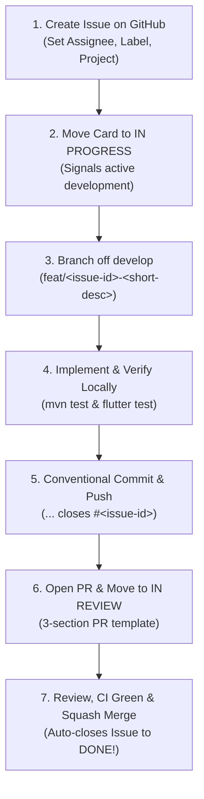
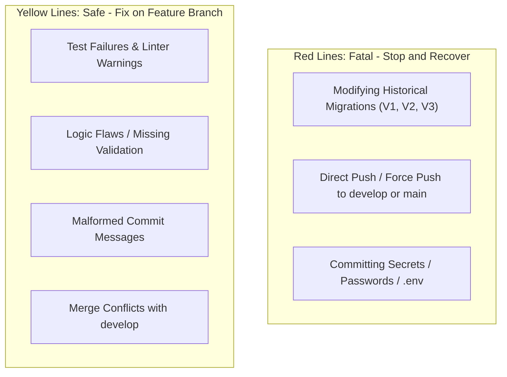

# Developer Workflow & Sprint Execution Playbook

> **Project:** Smart Local Planner  
> **Audience:** All Contributing Engineers, Peer Reviewers, and AI Coding Assistants  
> **Standard:** Enterprise Greenfield Agile Lifecycle & Zero-Debt Governance  
> **Reference Document:** Aligned with [CONTRIBUTING.md](../CONTRIBUTING.md) and [docs/DEVELOPMENT_GUIDELINES.md](DEVELOPMENT_GUIDELINES.md)

---

## 1. Overview & Operational Mindset

This playbook provides a deterministic, step-by-step Standard Operating Procedure (SOP) for executing tasks in **Smart Local Planner**. Every ticket follows an audited 7-step lifecycle connecting the GitHub Sprint Board, Git branch management, local dual-stack quality gates, and automated CI pipelines.



---

## 2. The 7-Step Sprint Ticket Lifecycle

### Step 1: Issue Creation on GitHub
1. Navigate to **Issues** ➔ Click **New Issue**.
2. **Title Format:**
   ```text
   [SLP-X] <Imperative Summary of Feature or Bugfix>
   ```
   *Example:* `[SLP-22] Implement JWT architecture, User entity and refresh token migration`
3. **Description Template:**
   ```markdown
   ### Description
   <High-level summary of the architectural requirement and context>

   ### Key Tasks
   1. <Task 1>
   2. <Task 2>
   3. <Task 3>

   ### Acceptance Criteria
   - [ ] <Measurable outcome 1>
   - [ ] <Measurable outcome 2>
   - [ ] All local and CI test suites pass with zero warnings.
   ```
4. **Metadata Sidebar (Mandatory):**
   * **Assignees:** Assign yourself (the developer executing the task).
   * **Labels:** Assign domain tag (`backend`, `mobile`) and type tag (`enhancement`, `bug`, `testing`).
   * **Projects:** Select **`Smart Local Planner - Sprint Tracking`**.

---

### Step 2: Project Board Transition (`Todo` ➔ `In Progress`)
1. Open the **Smart Local Planner - Sprint Tracking** board.
2. Locate the new issue card.
3. Drag the card from **Todo** to **In Progress**.
   > *Why?* This broadcasts team transparency, prevents duplicate work, and signals active sprint allocation.

---

### Step 3: Git Branch Creation
Always branch from the latest, pristine `develop` branch:

```bash
# Ensure local develop is clean and up to date
git checkout develop
git pull origin develop

# Create feature or fix branch mapped to the GitHub issue number
# Format: <type>/<issue_number>-<short-description>
git checkout -b feat/46-jwt-architecture
# or for bug fixes / maintenance:
git checkout -b fix/44-place-card-null-image-fallback
```

---

### Step 4: Implementation & Local Dual-Stack Quality Gates
Implement code following Clean Architecture and test-driven standards. **Before committing or pushing, you must execute the local quality gates.**

#### Backend Verification (Spring Boot 3 / Java 21)
```powershell
# Windows PowerShell
$env:JAVA_HOME = "C:\Users\<user>\.jdks\temurin-21.0.12.1"
$env:Path = "$env:JAVA_HOME\bin;" + $env:Path
Set-Location -Path "backend"
.\mvnw.cmd test
```
```bash
# Linux / macOS
cd backend
./mvnw test
```
*Gate Expectation:* **BUILD SUCCESS**, 0 failures, 0 errors. (Testcontainers integration tests automatically skip if local Docker is inactive).

#### Mobile Verification (Flutter 3.x / Dart)
```bash
cd mobile
flutter test
flutter analyze
```
*Gate Expectation:* All test cases passed, `No issues found!`.

---

### Step 5: Conventional Commit & Push
Stage only the modified project files and construct a Conventional Commit containing the ticket identifier and closing keyword:

```bash
# Review modified files
git status

# Stage changes
git add .

# Conventional Commit Format:
# <type>(<scope>): [SLP-X] <imperative description> (closes #<issue_number>)
git commit -m "feat(auth): [SLP-22] add jwt token provider and user entity (closes #46)"

# Push branch to remote origin
git push -u origin feat/46-jwt-architecture
```

---

### Step 6: Pull Request Submission & Board Transition (`In Progress` ➔ `In Review`)
1. Open the PR link generated by Git or visit GitHub repository PR tab.
2. **Branch Mapping:**
   * **Base:** `develop` ⬅️ **Compare:** `feat/<issue_number>-<short-description>`
3. **PR Title:** Matches the conventional commit subject without the closing keyword:
   ```text
   feat(auth): [SLP-22] add jwt token provider and user entity
   ```
4. **PR Body (Standard 3-Section Format):**
   ```markdown
   ## Summary of Changes
   - **<Component> (`<modified-files>`)**:
     - <Bullet point 1 detailing what was added/refactored>
     - <Bullet point 2>

   ## Verification
   - Backend test suite: <X> tests run, <Y> passed, BUILD SUCCESS.
   - Mobile test suite: <A> tests run, <B> passed, flutter analyze 0 issues.
   - CI Quality Gate: Verified green.

   Closes #<issue_number>
   ```
5. **PR Metadata Sidebar:**
   * **Reviewers:** Assign the Tech Lead / Peer Reviewer.
   * **Projects:** Select **`Smart Local Planner - Sprint Tracking`**.
6. **Board Action:**
   * Drag the card on the Sprint Board from **In Progress** to **In Review**.

---

### Step 7: Review, Quality Gates & Squash Merge
1. Wait for GitHub Actions automated quality gates to finish:
   * ✅ `Spring Boot 3 Compile & Verification`
   * ✅ `Flutter Mobile Quality Gate`
2. Tech Lead performs code review and approves the PR.
3. Click **Squash and merge** (Repository default).
4. **Automatic Magic:** GitHub auto-closes the linked issue and moves the board card to **Done**!
5. **Post-Merge Cleanup:**
   ```bash
   # Sync local develop and delete merged feature branch
   git checkout develop
   git pull origin develop
   git branch -d feat/46-jwt-architecture
   git remote prune origin
   ```

---

## 3. Red Lines vs. Yellow Lines: Psychological Safety Matrix

To eliminate fear and build confidence, understand the distinction between **fatal errors** (which impact the team) and **safe mistakes** (which are easily fixed on your branch).



### 🔴 Red Lines (Zero-Tolerance / Dangerous)

| Dangerous Action | Impact | Prevention & Emergency Recovery |
| :--- | :--- | :--- |
| **Modifying historical migrations (`V1`, `V2`, `V3`)** | Calculates a different SHA-256 checksum; crashes peer and server Flyway initialization. | **Rule:** Never edit existing SQL migrations. Always create an incremental `V4__...sql`.<br>**Recovery:** `git restore backend/src/main/resources/db/migration/V1...` |
| **Direct push or `git push --force` to `develop`/`main`** | Overwrites shared history and bypasses CI quality gates. | **Rule:** Always work on `feat/...` or `fix/...`.<br>**Protection:** Branch protection rules on GitHub strictly block direct pushes. |
| **Committing secrets (`.env`, passwords, JWT secrets, Cloudinary keys)** | Security breach; captured by public/private scanner bots. | **Rule:** `.gitignore` blocks `.env`. Only commit placeholder values in `.env.example`. |
| **Breaking API Contract silently** | Modifying DTO field names without updating `API_SPECIFICATION.md` breaks mobile app parsing. | **Rule:** API contracts are sacred. Update spec and coordinate with frontend before altering schemas. |

---

### 🟡 Yellow Lines (Safe & Recoverable Mistakes)

| Common Mistake | Why It Is Safe | How to Resolve |
| :--- | :--- | :--- |
| **Local or CI test failure** | It happens completely on your isolated branch. `develop` remains 100% green. | Read the error stack trace, fix the code, run `./mvnw test` or `flutter test`, and commit again. |
| **Linter warnings (`flutter analyze`)** | CI blocks merge; nothing broken on master branch. | Run `flutter analyze`, navigate to the flagged lines, fix unused imports or missing types, commit and push. |
| **Commit message formatted incorrectly** | Squash and merge combines all commits into 1 clean commit on `develop`. | The PR author or Tech Lead can edit the final commit title directly in the GitHub PR merge box before confirming! |
| **Merge conflict with `develop`** | Standard Git collaboration event when peer branches merge first. | On your branch: `git merge develop` (or `git rebase develop`). Resolve conflicted markers in your IDE, test, and push. |

---

## 4. Emergency Git Runbook

When an unexpected Git situation occurs, stay calm and use these standard recovery commands:

### Discard all uncommitted local modifications
```bash
git restore .
git clean -fd
```

### Temporarily save in-progress work to switch branches
```bash
git stash save "wip-work-in-progress"
# Later, restore it:
git stash pop
```

### Sync your feature branch with the latest changes from `develop`
```bash
git checkout feat/<your-branch>
git fetch origin
git merge origin/develop
# Run tests to ensure compatibility
```

---

## 5. AI Pair-Programming Protocol (Prompting Guide)

When collaborating with AI assistants (e.g. Antigravity, Claude, ChatGPT, Cursor), **provide explicit context upfront** to prevent AI hallucination, dependency drift, or architectural shortcuts.

### Copy-Paste System Prompt for AI Assistant
Whenever you start a new coding session with an AI, paste this directive first:

```text
You are assisting development on the enterprise project 'Smart Local Planner'.
Before proposing any code, review and adhere strictly to these project standards:
1. Architecture: Spring Boot 3 (Java 21) layered architecture and Flutter 3 (BLoC pattern).
2. Database: Flyway migrations are immutable. Never modify V1, V2, V3. Add new migrations incrementally (e.g., V4).
3. API Contracts: All REST endpoints, status codes, and DTO structures must conform exactly to docs/API_SPECIFICATION.md.
4. Git Discipline: Changes must belong to an isolated branch 'feat/<issue_number>-<desc>'. Commits must follow Conventional Commits: '<type>(<scope>): [SLP-X] <subject> (closes #<issue>)'.
5. Quality Gate: Code must compile and pass all tests (mvn test and flutter test / flutter analyze) with 0 warnings.
6. Language: Code, comments, commits, and PRs must be 100% Technical English.
Always verify that your proposed changes do not break existing test suites.
```

---

## 6. Definition of Done (DoD) Checklist

Before requesting a PR review, verify every item on this checklist:

- [ ] Code strictly follows Clean Architecture (Controllers delegate to Services; Entities never exposed directly in REST controllers).
- [ ] Database changes (if any) are isolated in a new incremental Flyway migration (`V<N>__...sql`).
- [ ] Automated tests cover happy paths and boundary/edge-case conditions.
- [ ] Backend test suite passes locally (`./mvnw test`).
- [ ] Mobile tests pass and static analysis is completely clean (`flutter analyze` & `flutter test`).
- [ ] PR title follows Conventional Commits format.
- [ ] PR description uses the standard 3-section template and contains `Closes #<issue_number>`.
- [ ] Sprint Board card is placed in **In Review**.
